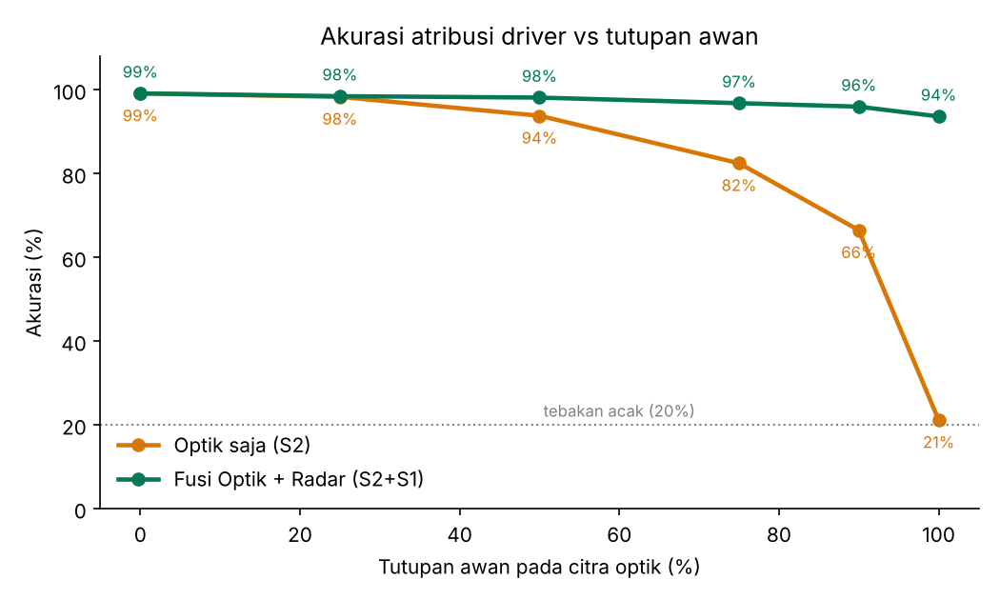
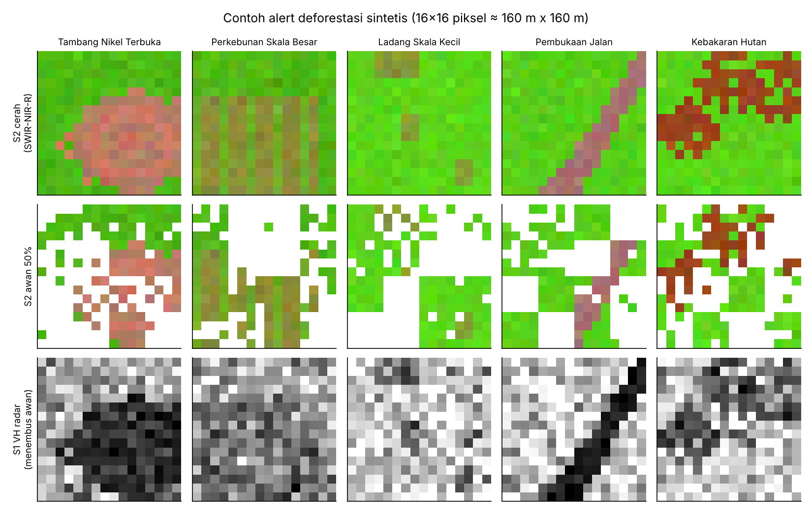
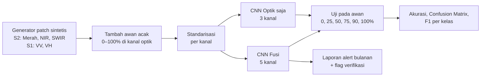
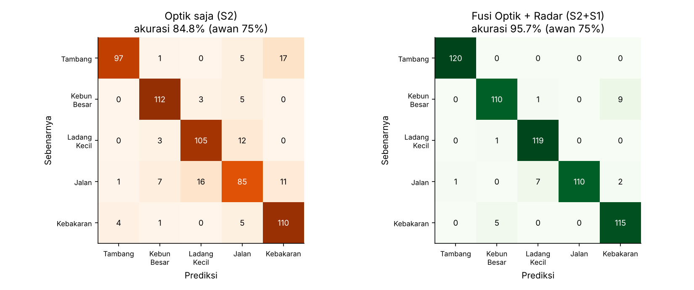
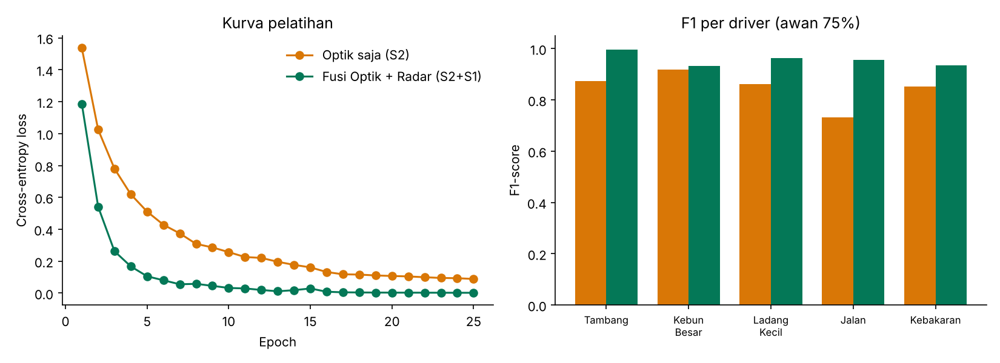

<div align="center">

# 🛰️ RadarHutan Sultra
### Atribusi Penyebab Deforestasi di Bawah Awan dengan Fusi Sentinel-1 + Sentinel-2 dan CNN


*Studi kasus pengembangan dari Sesi 6 — **"Attributing direct drivers to deforestation alerts with satellite imagery and AI"** oleh Bart Slagter (Wageningen University & Research), 19 Oktober 2026.*

</div>

---

## 📌 Ringkasan

Sistem peringatan deforestasi biasanya hanya memberi tahu **di mana** hutan hilang, bukan **apa penyebabnya**. Materi sesi 6 menunjukkan bahwa CNN bisa mengenali penyebab (*driver*) dari pola citra satelit. Masalahnya, di daerah tropis seperti **Sulawesi Tenggara**, citra optik sering tertutup awan.

Proyek ini menguji satu pertanyaan sederhana:

> **Seberapa besar radar Sentinel-1 membantu CNN mengenali penyebab deforestasi ketika citra optik Sentinel-2 tertutup awan?**

**Jawaban singkat:** pada awan 100%, model optik saja jatuh ke **21%** (setara menebak), sedangkan model fusi optik + radar tetap **94%**.

<p align="center"></p>

---

## 🗂️ Daftar Isi
1. [Latar Belakang](#-latar-belakang)
2. [Studi Kasus](#-studi-kasus)
3. [Rumusan Masalah](#-rumusan-masalah)
4. [Batasan Masalah](#-batasan-masalah)
5. [Tujuan](#-tujuan)
6. [Metodologi](#-metodologi)
7. [Struktur Proyek](#-struktur-proyek)
8. [Cara Menjalankan](#-cara-menjalankan)
9. [Hasil dan Pembahasan](#-hasil-dan-pembahasan)
10. [Keterbatasan dan Pengembangan](#-keterbatasan-dan-pengembangan)
11. [Kesimpulan](#-kesimpulan)
12. [Referensi](#-referensi)
13. [Identitas Mahasiswa](#-identitas-mahasiswa)

---

## 🌳 Latar Belakang

Hutan tropis menyimpan karbon, mengatur siklus air, dan menopang keanekaragaman hayati serta kehidupan masyarakat. Hilangnya hutan terutama dipicu oleh perubahan fungsi lahan (pertanian, perkebunan) dan ekstraksi sumber daya (tambang, kayu).

Dari materi sesi 6, ada tiga poin kunci yang menjadi dasar proyek ini:

| Poin dari Materi | Dipakai di Proyek Ini |
|---|---|
| Alert deforestasi hanya memberi lokasi, bukan penyebab | Setiap patch = satu alert, model menebak **penyebabnya** |
| Satelit optik terhalang awan, radar menembus awan | Dibandingkan model **optik saja** vs **optik + radar** |
| CNN membaca pola spasial dari tumpukan citra bulanan | CNN 2 lapis konvolusi dibangun **dari nol dengan NumPy** |

---

## 📍 Studi Kasus

**Wilayah ilustrasi:** Kabupaten Kolaka dan sekitarnya, Sulawesi Tenggara.

Wilayah ini dipilih karena memiliki campuran penyebab deforestasi yang beragam dalam area yang berdekatan: **tambang nikel laterit terbuka**, perkebunan, ladang masyarakat, pembukaan jalan akses, dan kebakaran lahan di musim kemarau. Pada musim hujan, tutupan awan tinggi membuat citra optik sering tidak bisa dipakai, sehingga pemantauan rawan "buta" berminggu-minggu.

**Skenario:** sebuah tim pemantau menerima puluhan alert deforestasi tiap bulan. Mereka ingin setiap alert otomatis diberi label penyebabnya, dan alert yang meragukan ditandai untuk diverifikasi ke lapangan.

### 5 Kelas Driver

| # | Driver | Ciri Pola Spasial (yang dipelajari CNN) |
|---|---|---|
| 0 | ⛏️ **Tambang Nikel Terbuka** | Bukaan besar, tanah laterit kemerahan, teras bertingkat berbentuk cincin |
| 1 | 🌴 **Perkebunan Skala Besar** | Blok persegi luas dengan baris tanam yang teratur |
| 2 | 🌾 **Ladang Skala Kecil** | Beberapa petak kecil tersebar (pola mosaik) |
| 3 | 🛣️ **Pembukaan Jalan** | Garis tipis memanjang, kadang bercabang |
| 4 | 🔥 **Kebakaran Hutan** | Area tak beraturan, NIR rendah, masih ada sisa pohon di dalamnya |

<p align="center"></p>
<p align="center"><sub>Baris 1: optik cerah · Baris 2: optik tertutup awan 50% (putih) · Baris 3: radar VH, pola tetap terlihat walau ada awan.</sub></p>

---

## ❓ Rumusan Masalah

1. Bagaimana membangun model CNN sederhana yang dapat mengklasifikasikan penyebab langsung deforestasi dari patch citra satelit?
2. Bagaimana pengaruh tingkat tutupan awan (0–100%) terhadap akurasi model yang hanya memakai citra optik?
3. Seberapa besar peningkatan akurasi bila data radar Sentinel-1 digabungkan (fusi) dengan citra optik Sentinel-2?

---

## 🚧 Batasan Masalah

Agar studi kasus tetap fokus dan bisa dijalankan di laptop biasa, ditetapkan batasan berikut:

| Aspek | Batasan |
|---|---|
| **Data** | Menggunakan **data sintetis** yang meniru karakter Sentinel-1 dan Sentinel-2, **bukan** citra satelit asli. Nilai spektral dan bentuk spasial disederhanakan. |
| **Kanal** | 5 kanal: B4 (Merah), B8 (NIR), B11 (SWIR) dari Sentinel-2; VV dan VH dari Sentinel-1. |
| **Ukuran patch** | 16 × 16 piksel (≈ 160 m × 160 m pada resolusi 10 m). |
| **Kelas** | Hanya 5 driver, dan **satu patch berisi satu driver** (tidak ada campuran). |
| **Awan** | Awan dimodelkan sebagai piksel putih terang yang hanya merusak kanal optik. Bayangan awan, kabut tipis, dan efek medan pada radar tidak dimodelkan. |
| **Radar** | Diasumsikan komposit median bulanan (~5 akuisisi), sehingga speckle sudah dihaluskan. |
| **Waktu** | Satu komposit per alert (tidak memakai deret waktu multi-bulan). |
| **Model** | CNN kecil (2 konvolusi) tanpa *framework* deep learning, agar mudah dipelajari. |
| **Lokasi** | Koordinat di laporan alert dibangkitkan **acak** di sekitar Kolaka sebagai ilustrasi, bukan lokasi kejadian nyata. |
| **Lingkup** | Tidak membahas aspek hukum, kepemilikan lahan, atau verifikasi lapangan. |

> ⚠️ Karena datanya sintetis, angka akurasi di sini **tidak bisa dibandingkan** langsung dengan model Wageningen yang dilatih dengan citra asli. Yang ingin ditunjukkan adalah **perbandingan relatif** optik vs fusi.

---

## 🎯 Tujuan

- Mengimplementasikan CNN dari nol (forward + backward + Adam) dengan NumPy.
- Mengukur penurunan akurasi model optik saja pada berbagai tingkat awan.
- Membuktikan manfaat fusi radar–optik dalam kondisi berawan.
- Menghasilkan contoh **laporan alert bulanan** berlabel driver beserta tingkat keyakinannya.

---

## 🔬 Metodologi



### Arsitektur CNN

```
Input (C × 16 × 16)          C = 3 (optik) atau 5 (fusi)
 ├─ Conv 3×3, 8 filter  → ReLU → MaxPool 2×2   → 8 × 8 × 8
 ├─ Conv 3×3, 16 filter → ReLU → MaxPool 2×2   → 16 × 4 × 4
 └─ Flatten (256) → Dense (5) → Softmax
```

| Pengaturan | Nilai |
|---|---|
| Data latih | 3.000 patch (600 per kelas), awan acak 0–100% |
| Data uji | 600 patch per tingkat awan (120 per kelas), seed berbeda |
| Optimizer | Adam, learning rate 0,003 → 0,001 setelah epoch 15 |
| Epoch / batch | 25 / 32 |
| Loss | Cross-entropy |
| Waktu latih | ± 40 detik di CPU (kedua model) |

Kebenaran *backpropagation* diverifikasi dengan **gradient check numerik** (selisih gradien analitik vs numerik < 10⁻⁹).

---

## 📁 Struktur Proyek

```
deforestasi-driver-sultra/
├── main.py                  # Jalankan semua: latih, uji, grafik, laporan
├── requirements.txt         # numpy, matplotlib
├── src/
│   ├── data_sintetis.py     # Generator patch S1 + S2 dan awan
│   └── cnn_numpy.py         # CNN dari nol (Conv, ReLU, MaxPool, Dense, Adam)
├── hasil/
│   ├── 1_akurasi_vs_awan.png
│   ├── 2_confusion_matrix.png
│   ├── 3_contoh_patch.png
│   ├── 4_loss_dan_f1.png
│   ├── akurasi_vs_awan.csv
│   ├── f1_per_kelas_awan75.csv
│   ├── laporan_alert_bulanan.csv
│   ├── log_pelatihan.txt
│   └── bobot_*.npz, normalisasi.npz   # bobot model tersimpan
├── docs/
│   └── PANDUAN_GITHUB.md    # Langkah upload ke GitHub
├── .gitignore
└── LICENSE
```

---

## ▶️ Cara Menjalankan

```bash
# 1. Clone repository
git clone https://github.com/keniafeblia/Session-06-Deforestasi.git
cd Session-06-Deforestasi

# 2. Install dependensi (hanya 2 library)
pip install -r requirements.txt

# 3. Jalankan
python main.py
```

Bisa juga dijalankan di **Google Colab**: upload folder, lalu jalankan `!python main.py`.

Hasil bersifat **deterministik** (seed tetap), jadi angka yang keluar akan sama dengan yang ada di README ini.

---

## 📊 Hasil dan Pembahasan

### 1. Akurasi terhadap Tutupan Awan

| Tutupan Awan | Optik saja (S2) | Fusi S2 + S1 | Selisih |
|:---:|:---:|:---:|:---:|
| 0% | 99,2% | 99,2% | 0,0 |
| 25% | 98,3% | 98,5% | +0,2 |
| 50% | 93,8% | 98,2% | +4,4 |
| 75% | 82,5% | 96,8% | **+14,3** |
| 90% | 66,5% | 96,0% | **+29,5** |
| 100% | 21,2% | 93,7% | **+72,5** |

**Pembahasan:**
- Saat langit cerah, kedua model **sama baiknya**. Radar tidak menambah banyak karena citra optik sudah cukup jelas.
- Mulai awan 50%, model optik mulai kehilangan informasi bentuk. Pada **awan 100%**, model optik praktis **menebak** (21%, mendekati peluang acak 20%).
- Model fusi hanya turun sekitar 5 poin dari cerah ke tertutup total, karena CNN belajar **beralih mengandalkan kanal radar** ketika kanal optik tidak berguna.

### 2. Confusion Matrix (awan 75%)

<p align="center"></p>

- Model optik paling sering salah pada **Pembukaan Jalan**, yang tertukar dengan Ladang Kecil dan Kebakaran. Jalan itu objek tipis, sehingga mudah "terputus" oleh awan.
- **Tambang** pada model optik sering tertukar dengan **Kebakaran**: keduanya tampak sebagai bukaan besar non-vegetasi bila sebagian tertutup awan. Ini mirip temuan pemateri bahwa model kadang sulit membedakan kelas yang tampak serupa.
- Model fusi mengenali **seluruh 120 patch tambang** dengan benar. Kesalahan yang tersisa kebanyakan Kebun Besar ↔ Kebakaran.

### 3. F1-score per Driver (awan 75%)

<p align="center"></p>

| Driver | Optik | Fusi |
|---|:---:|:---:|
| Tambang Nikel Terbuka | 0,87 | **1,00** |
| Perkebunan Skala Besar | 0,92 | 0,93 |
| Ladang Skala Kecil | 0,86 | 0,96 |
| Pembukaan Jalan | 0,73 | **0,96** |
| Kebakaran Hutan | 0,85 | 0,94 |

Peningkatan terbesar ada pada **Pembukaan Jalan** (+0,23) dan **Tambang** (+0,12), dua driver yang paling relevan untuk wilayah tambang seperti Kolaka.

### 4. Laporan Alert Bulanan (Contoh Penerapan)

File `hasil/laporan_alert_bulanan.csv` mensimulasikan **40 alert** dalam satu bulan dengan tutupan awan acak 0–100%. Model fusi memberi label driver dan nilai keyakinan. Alert dengan keyakinan < 0,70 otomatis diberi status **PERLU VERIFIKASI LAPANGAN**.

| id_alert | tutupan_awan | driver_prediksi | keyakinan | status |
|---|:---:|---|:---:|---|
| ALR-001 | 52% | Kebakaran Hutan | 1,00 | OTOMATIS |
| ALR-002 | 43% | Tambang Nikel Terbuka | 1,00 | OTOMATIS |
| ALR-004 | 1% | Pembukaan Jalan | 1,00 | OTOMATIS |
| ALR-013 | 79% | Pembukaan Jalan | 0,53 | PERLU VERIFIKASI LAPANGAN |

Hasil: **40 dari 40 alert** terlabel benar, dan 1 alert ditandai untuk dicek ke lapangan. Rekap bulan itu: Jalan 12, Tambang 9, Kebun Besar 8, Kebakaran 7, Ladang Kecil 4. Rekap seperti ini membantu menentukan prioritas patroli dan kebijakan.

---

## ⚠️ Keterbatasan dan Pengembangan

**Keterbatasan**
- Data sintetis jauh lebih "bersih" dibanding citra asli, sehingga akurasi terlihat sangat tinggi.
- Model fusi mencapai loss latih hampir nol, yang menandakan potensi **overfitting** bila dipakai pada data nyata.
- Belum memodelkan alert yang berisi **lebih dari satu driver**, misalnya tambang yang memicu ladang di sekitarnya seperti contoh Kongo pada materi.
- Masih memakai satu komposit, sehingga *latency* bulanan yang disebut pemateri juga berlaku di sini.

**Pengembangan Selanjutnya**
1. Mengganti data sintetis dengan citra asli Sentinel-1/2 dari **Google Earth Engine**, dengan label dari interpretasi visual atau data lapangan.
2. Menambahkan kanal **deret waktu** (sebelum dan sesudah gangguan) agar banjir dan bekas kebakaran lebih mudah dibedakan.
3. Menambahkan *data augmentation* (rotasi, flip) dan *dropout* untuk mengurangi overfitting.
4. Memakai klasifikasi **multi-label** untuk alert dengan beberapa driver sekaligus.
5. Memindahkan model ke PyTorch dan membuat dashboard peta alert.

---

## ✅ Kesimpulan

1. CNN sederhana yang dibangun dari nol dengan NumPy mampu mengenali 5 penyebab deforestasi dari pola spasial citra satelit.
2. Akurasi model **optik saja** turun tajam seiring bertambahnya awan, dari 99% (cerah) menjadi 21% (tertutup total).
3. **Fusi radar Sentinel-1 + optik Sentinel-2** menjaga akurasi tetap di atas 93% bahkan saat awan 100%. Ini mendukung pernyataan pemateri bahwa radar adalah solusi untuk pemantauan hutan tropis yang sering berawan.
4. Output berupa laporan alert berlabel driver dan tingkat keyakinan bisa membantu transparansi, penegakan hukum, dan pembuatan kebijakan, sesuai kesimpulan materi sesi 6.

---

## 📚 Referensi

- Slagter, B. (2026). *Attributing direct drivers to deforestation alerts with satellite imagery and AI*. Materi Sesi 6, 19 Oktober 2026. Wageningen University & Research.
- European Space Agency. *Sentinel-1 dan Sentinel-2 Mission Guide*. https://sentinels.copernicus.eu
- Goodfellow, I., Bengio, Y., & Courville, A. (2016). *Deep Learning*. MIT Press. Bab 9: Convolutional Networks.
- Kingma, D. P., & Ba, J. (2015). *Adam: A Method for Stochastic Optimization*. ICLR.

---

## 👤 Identitas Mahasiswa

| Informasi | Keterangan |
|---|---|
| **Nama Lengkap** | **Kenia Nurma Feblia** |
| **NPM** | **G1A023004** |
| **Program Studi** | Informatika |
| **Universitas** | Universitas Bengkulu |
| **Studi Kasus** | Sesi 06 — *Attributing direct drivers to deforestation alerts with satellite imagery and AI* |
| **Repository GitHub** | [Session-06-Deforestasi](https://github.com/keniafeblia/Session-06-Deforestasi) |

---

<div align="center">

**Disusun Oleh:**  
### **Kenia Nurma Feblia**  
**NPM: G1A023004**  
**Program Studi Informatika — Universitas Bengkulu**

<br/>

Dibuat sebagai tugas studi kasus Sesi 6 · Lisensi [MIT](LICENSE)

</div>
